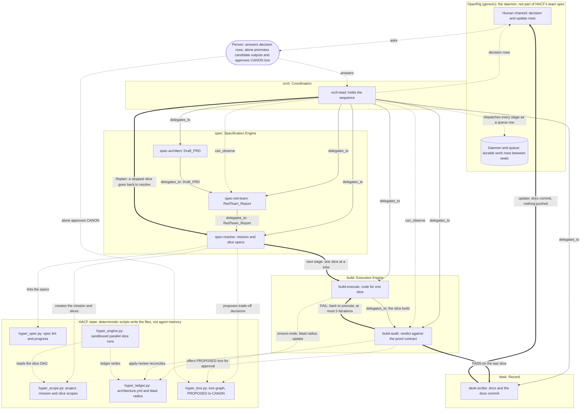

<div align="center">
    
    <h1>Hypergraph Agentic Coding Framework (Coding 4.1)</h1>
    <h3><em>A staged, fresh-context pipeline for AI-assisted coding: specify, attack, resolve, build, audit. Run it stage by stage yourself, or as a team of OpenRig agent seats.</em></h3>
</div>

<p align="center">
    <strong>HACF turns a feature request into a specification that is drafted, attacked and resolved in separate fresh-context stages before any code is written, then builds it one slice at a time and audits each slice against that specification. Each stage can run as its own long-lived agent seat in an OpenRig team, with a lead seat handing the work along. Project state lives in files that scripts write, not in an agent's memory, and a decision an agent proposes binds the other agents only after a person approves it.</strong>
</p>

<p align="center">
    <a href="https://github.com/tjmustard/Hypergraph-Agentic-Coding-Framework/releases/latest"></a>
    <a href="https://github.com/tjmustard/Hypergraph-Agentic-Coding-Framework/stargazers"></a>
    <a href="https://github.com/tjmustard/Hypergraph-Agentic-Coding-Framework/blob/main/LICENSE"></a>
</p>


---

## Table of Contents

- [🤔 What is the Hypergraph Agentic Coding Framework?](#-what-is-the-hypergraph-agentic-coding-framework)
- [⚡ Get Started](#-get-started)
- [📚 Core Architecture](#-core-architecture)
- [👥 Running HACF with an OpenRig Team](#-running-hacf-with-an-openrig-team)
- [📂 Directory Structure](#-directory-structure)
- [🤖 Supported Integrations & Commands](#-supported-integrations--commands)
- [📖 Detailed Tutorials & Scripts](#-detailed-tutorials--scripts)
- [📖 Standard Operating Procedure (SOP)](#-standard-operating-procedure-sop)
- [🎯 Models and Cost Control](#-models-and-cost-control)
- [❓ Troubleshooting Overview](#-troubleshooting-overview)
- [🚧 Known Issues and Limitations](#-known-issues-and-limitations)
- [🗺️ Roadmap](#-roadmap)
- [🤝 Support](#-support)
- [📄 License](#-license)

## 🤔 What is the Hypergraph Agentic Coding Framework?

The Hypergraph Agentic Coding Framework (HACF) is a set of agent skills, Python scripts and git hooks that you install **into** your own repository. It works on the **Specification Alignment Problem**: an agent that holds a whole specification in one context window tends to drift, forgetting a constraint or inventing a requirement. HACF's answer, in the spirit of **Coding 4.1** (you write the intent and make the decisions, agents write the syntax and hand the work between stages), is structure:

- **A staged pipeline.** Architect, red team and resolve turn your intent into a mission spec and one spec per slice; execute builds one slice; audit checks it against that slice's proof contract. Each stage starts in a fresh context window and reads the files the previous stage wrote.
- **State written by scripts.** Specs, the component ledger and the lore graph are files with schemas, written by validating scripts rather than edited freehand by an agent.
- **Human-gated decisions.** Agents propose decisions; only a person approves one into binding canon (CANON) or promotes a novel test output to a fixture. A decision the person made is recorded as such and binds at once.

**What "hypergraph" means now.** The hypergraph is HACF's *context* graph, the **lore**: decisions (ADRs), stories and binding canon in `lore_hypergraph.yml` and `lore/`, which agents read as constraints. It does not model your code. Code is tracked by the **component ledger**, a coarse map of components and their files, and, when you turn it on, by an optional **code graph** built by a separate tool (see [Core Architecture](#-core-architecture)).

### From Coding 4.0 to Coding 4.1

Coding 4.0 was HACF as five skills you ran in order: `/hyper-architect`, `/hyper-redteam`, `/hyper-resolve`, `/hyper-execute` and `/hyper-audit`, each in a new context window. Coding 4.1 keeps those stages and their files, and adds a way to run them as a team of [OpenRig](https://www.openrig.dev) agents.

| | Coding 4.0: you run the stages | Coding 4.1: an OpenRig team runs the stages |
|---|---|---|
| Who moves work between stages | You, by starting the next `/hyper-*` skill | `orch-lead`, which dispatches each stage to its seat as a queue row |
| Where the fresh context comes from | A new context window per stage, opened by you | One long-lived seat per stage: 7 seats in 4 pods (orch, spec, build, desk) |
| Audit FAIL and Replan | You rerun `/hyper-execute` or `/hyper-resolve` | Queue handoffs: FAIL goes back to `build-execute` (at most 5 iterations); a stopped slice goes back to `spec-resolve` |
| Docs after the last slice | You run `/hyper-document` | `desk-scribe` writes the docs commit; nothing is pushed |
| Parallel slice builds | `hyper_engine.py run`, sandboxed worktrees | The same engine, available in either mode |
| Project state | Files written by `hyper_scope.py`, `hyper_spec.py`, `hyper_ledger.py`, `hyper_lore.py` | The same files, written by the same scripts |
| Human gates | Architect interview, forced trade-offs, CANON approval, candidate-output promotion | The same gates, reached through decision rows on the human channel |
| Starting it | Nothing to start | `bash HACF-install.sh --rig`, then `rig up` by hand |

**Why 4.1 and not 5.0.** The handoffs between stages are automated; the judgement is not. The architect still interviews you one question at a time, resolve still makes you choose between forced trade-offs, only you approve a lore node into CANON (`/hyper-lore-approve`, or Phase 3.5 of `/hyper-audit`), and only you promote a novel test output into `tests/fixtures/`. A seat that needs one of those decisions posts a decision row and waits for your answer.

The five skills still work on their own, with no OpenRig installed. OpenRig support is partial and is described as it stands in [Running HACF with an OpenRig Team](#-running-hacf-with-an-openrig-team).

## ⚡ Get Started

### Supported Platforms

| Platform | Status |
|---|---|
| Linux (Ubuntu 22.04+, Debian 12+) | Supported and tested |
| WSL2 | Supported and tested |
| macOS | Best-effort: needs bash >= 4 (`brew install bash`); the engine's bwrap oracle sandbox is Linux-only |

Every script needs `python3` >= 3.10 and PyYAML >= 5.4. Every command in these docs uses `python3`.

### New Project

HACF is a toolchain you install **into** your own repository. Never clone the HACF repository and build your project inside it.

1.  Create your project directory and make it a git repository:
    ```bash
    mkdir my-project && cd my-project
    git init
    ```
2.  Download the installer and run it from the project root:
    ```bash
    curl -sSL https://raw.githubusercontent.com/tjmustard/Hypergraph-Agentic-Coding-Framework/main/HACF-install.sh -o HACF-install.sh
    bash HACF-install.sh
    ```
3.  Run `/hyper-init` to generate standard repository docs (`README.md`, `CONTRIBUTING.md`, …), then `/hyper-architect` to specify your first feature.

### Installing into an Existing Repo

Download the installer fresh every time and run it from your project root:

```bash
curl -sSL https://raw.githubusercontent.com/tjmustard/Hypergraph-Agentic-Coding-Framework/main/HACF-install.sh -o HACF-install.sh && bash HACF-install.sh
```

The installer checks git, bash >= 4, `python3` >= 3.10 and PyYAML >= 5.4 before it writes anything, then:

1. asks which IDE(s) to support (or takes `--ides=`);
2. copies `.agents/` (skills, scripts, schemas, rules, config) and the IDE bridges;
3. runs the project scaffold, `python3 .agents/scripts/hyper_scaffold.py apply` (see below);
4. writes the HACF managed block into `AGENTS.md`, `CLAUDE.md` and `GEMINI.md`, keeping every byte outside it;
5. merges its Claude Code settings and renders the agent firewall from `.agentignore`;
6. installs the git hooks: `pre-commit` (staged files only), `commit-msg` and `pre-push` (blocks pushing `research/*` and `swimlane/*` branches);
7. writes `.agents/hacf-manifest.json`, which the uninstaller and `/hyper-update` use.

**What the scaffold creates.** `hyper_scaffold.py apply` creates only what is missing and reports each item as `created`, `kept`, `adopted` or `skipped`; a second run writes nothing. It creates the root `SPEC.md`, `project.yaml`, `workspace.yaml` and `missions/` (OpenRig manifests are adopted unchanged); the lore tree `lore/ADRs/`, `lore/STORIES/`, `lore/proposed/` and `lore/canon/`; and, when no lore graph exists, an empty `lore_hypergraph.yml` with `lore/MAP.md` and `lore/CANON.md`, written by `python3 .agents/scripts/hyper_lore.py init`. An existing lore graph is kept unchanged. It also writes `.agents/local/hacf.yml`, `.agents/state/.gitignore`, `.agents/memory/activeContext.md`, the `spec/` and `tests/` directories, a managed block in `.gitignore`, and the lore merge drivers (repo-local git config plus `<git-common-dir>/info/attributes`, never a tracked `.gitattributes`). A root item that already exists and is not HACF's or OpenRig's stops the scaffold before it writes anything.

#### Installer flags

```bash
bash HACF-install.sh                         # interactive
bash HACF-install.sh --ides=claude,cursor    # these IDEs only
bash HACF-install.sh -y --ides=claude        # defaults for every question; consents to nothing
bash HACF-install.sh --dry-run               # print every write, merge and download; write nothing
```

| Flag | Meaning |
|---|---|
| `-y`, `--yes` | Answer every question with its default. It never consents to a download or third-party code. |
| `--ides=a,b` \| `all` | IDEs: `claude`, `antigravity`, `windsurf`, `cursor`, `cline`, `roo`, `universal` |
| `--mode=M` | Upgrade mode: `full`, `skills`, `system`, `ide`, `repair`, `dry-run` |
| `--files=a,b` | Install the named files only, skipping existing ones |
| `--preserve-custom` | Leave `AGENTS.md`, `CLAUDE.md` and `GEMINI.md` untouched |
| `--dry-run` | Print every write, merge and download; write nothing |
| `--install-deps` | Consent to `python3 -m pip install --user pyyaml` when PyYAML is missing |
| `--code-graph=none\|codebase-memory-mcp` | Select the code-graph backend |
| `--install-code-graph` | Consent to installing codebase-memory-mcp 0.12.1 |
| `--statusline` | Consent to a statusLine that runs `npx -y ccstatusline@latest` |
| `--migrate` | Print (or, interactively, run) the v0.6.0 migration plan |
| `--firewall=auto\|off` | Render `.agentignore` into each selected IDE (default `auto`) |
| `--repo-url=URL` | Upstream repository; `https://` only |
| `--branch=NAME` | Upstream branch (default `main`) |
| `--source=PATH` | Install from a commit of a local HACF git checkout instead of cloning (see below) |
| `--ref=REF` | Commit, branch or tag in `--source` (default `HEAD`). Without `--source`, on a project installed from a local checkout: move to `REF` in that checkout |
| `--rig[=DEST]` | Copy HACF's OpenRig team spec to `openrig/hacf/` (or DEST); never over an existing path |

Each consent flag is the consent for its own action; `-y` never downloads third-party code (the installer still clones the HACF upstream). The upstream changes only through `--repo-url` and `--branch`. The environment overrides `HACF_REPO_URL`, `HACF_BRANCH` and `HACF_UPSTREAM_URL` apply only with `HACF_TEST=1` (the end-to-end tests), and a non-`https://` upstream is refused outside tests. Every consent prompt and log line prints the effective upstream URL and commit.

If you select the codebase-memory-mcp backend, the installer adds it to the tracked `.mcp.json`, `.cursor/mcp.json` and `.roo/mcp.json`, and every teammate who accepts that project server runs it. The entry depends on how the installer installed the server: after the uvx method, or when it installed nothing, the entry runs `uvx codebase-memory-mcp@0.12.1` (exact pin); after the uv-tool or vendor-script method, it runs the unpinned `codebase-memory-mcp` command, so each teammate gets whatever binary of that name is on their PATH. See [docs/Lore.md](docs/Lore.md#mcp-server-entries).

To run HACF with a per-project OpenRig team, see [docs/OpenRig-Team.md](docs/OpenRig-Team.md).

#### Install from a local checkout (unpushed HACF)

```bash
bash /path/to/hacf/HACF-install.sh --source=/path/to/hacf [--ref=<commit|branch|tag>]
```

- Only the commit is installed, never the checkout's working tree. A dirty checkout gets a warning, and its uncommitted changes are not installed. No network is used for HACF itself, but `--dry-run` with `--source` still fetches the commit into a temp dir.
- The full sha is printed before anything is written.
- The committed manifest records only `source: {kind: local, commit}`. The checkout's absolute path goes only to the gitignored, per-machine `.agents/state/install/source.json`.
- A plain re-run of `HACF-install.sh` (no `--source`, `--repo-url` or `--branch`) uses the recorded checkout and reinstalls the manifest's `installed_commit`. If the checkout's `HEAD` has moved to another commit, the re-run refuses, writes nothing, and prints the two commands to choose from: `--ref=<installed sha>` to reinstall what is installed, or `--ref=<head sha>` to move. `--source=<the recorded checkout>` without `--ref` is pinned the same way; `--source` naming another checkout installs that checkout's `HEAD`. To move, pass `--ref` alone: on a project installed from a local checkout, `--ref` no longer needs `--source`. This protects re-runs of a v0.6.3+ installer; a checkout moved to an older commit runs that commit's older installer. A plain `HACF-uninstall.sh` uses the recorded checkout and the installed commit (`--ref` defaults to the manifest's `installed_commit`). Both refuse, and change nothing, when the recorded source is gone or no longer matches the install: pass `--source=<checkout>`, or `--repo-url=<https url>` to use a remote instead.
- `--source` cannot be combined with `--repo-url` or `--branch`, on either script.
- `/hyper-update` cannot update a local-source install yet; see the [0.6.0 known issues](CHANGELOG.md#known-issues-1).

#### Surgical file install

`--files=` adds individual files without touching anything else and never overwrites an existing file:

| Target | Installs |
|---|---|
| `pre-commit` | `.agents/scripts/pre-commit` → `.git/hooks/pre-commit` |
| `commit-msg` | `.agents/scripts/commit-msg` → `.git/hooks/commit-msg` |
| `pre-push` | `.agents/scripts/pre-push` → `.git/hooks/pre-push` |
| `pyproject-template` | ruff config template → `.agents/schemas/project-templates/pyproject.toml` |
| `python-rules` | `.agents/rules/python.md` |
| `testing-rules` | `.agents/rules/testing.md` |
| `security-rules` | `.agents/rules/security.md` |
| `package-rules` | `.agents/rules/package-management.md` |
| `git-workflow-rules` | `.agents/rules/git-workflow.md` |

> **Naming convention:** all framework skills and commands use the `hyper-` prefix (e.g. `hyper-architect`, `/hyper-redteam`) so they never collide with your own.

### Upgrading an Existing Installation

**First, delete any saved copy of HACF-uninstall.sh** from your project and your downloads. A saved v0.5.x uninstaller deletes every project file whose path also exists in the HACF repository, including `.gitattributes` (your Git LFS rules), `lore_hypergraph.yml`, `SPEC.md`, `project.yaml`, `workspace.yaml` and `docs/*`. The installer warns about `./HACF-uninstall.sh` and offers to replace it, but it cannot see copies saved elsewhere.

Then:

- **Always re-download the installer** (the `curl` command above). A saved v0.5.x installer copies the system directories and then aborts at `tests/`, leaving a half-upgraded project; run a fresh installer to complete it.
- Re-running the installer in a project that has `.agents/hacf-manifest.json` (or a v0.5.x `.agents/scripts/hypergraph_updater.py`) switches to upgrade mode, with a menu or `--mode=`. Files you changed are backed up to `.agents/.backup/<timestamp>/` before they are replaced.
- To move v0.5.x specs to the v0.6.0 layout, run the migration (see [Migrating specs to v0.6.0](#migrating-specs-to-v060)).

### Updating with `/hyper-update`

After installation, `/hyper-update` upgrades the framework files and keeps your work. The agent runs only the read-only preview, `python3 .agents/scripts/hyper_update_core.py --dry-run`, and gives you the command to run in your own terminal.

- **Releases are unsigned in v0.6.x.** An unsigned upstream needs your consent in a terminal: the prompt, or `--allow-unsigned`. `--allow-unsigned` needs a TTY and is refused under `HACF_AUTONOMOUS=1`, so **unattended CI updates are not possible** while releases are unsigned. Every consent is logged to `.agents/logs/update-consent.jsonl` with the URL and commit.
- **Any future release signing will use SSH signatures only.** Never import a signing key into a global keyring or global git config. Allowed signers are pinned machine-locally in `.agents/state/upstream-trust.json` on first trust; the upstream's `.agents/config/upstream.yml` is only a proposal, and a change to the pinned set needs your interactive consent.
- **Anti-rollback:** an upstream commit that does not descend from the installed one is refused unless you pass `--allow-downgrade`.
- The upstream changes only through `--upstream-url <https-url>` and `--ref <ref>`.
- Only `.agents/skills/`, `.agents/scripts/` and `.agents/schemas/` are synced; `AGENTS.md`, `CLAUDE.md`, `GEMINI.md` and `.agentignore` get only their HACF block. Your specs, tests, lore, missions and settings are never synced.

Details: [docs/MIGRATION_RULES.md](docs/MIGRATION_RULES.md#updating-hacf-adr-0010).

### Migrating specs to v0.6.0

```bash
python3 .agents/scripts/hyper_migrate.py detect     # report the legacy signals; writes nothing
python3 .agents/scripts/hyper_migrate.py plan       # print the action list; writes nothing
python3 .agents/scripts/hyper_migrate.py apply      # backup and journal first; needs a typed yes on a TTY
python3 .agents/scripts/hyper_migrate.py verify
```

`apply` asks for a typed `yes` in a terminal; `rollback --journal .agents/state/migrations/v0.6.0.json` restores the pre-apply tree and refuses when files changed since the apply (`--force` overrides). Legacy flat `spec/compiled/MiniPRD_*.md` files are still read until v0.7.0 (no earlier than 2027-01-31).

### Uninstalling

**First, delete any saved copy of HACF-uninstall.sh** that is older than v0.6.0: a saved v0.5.x uninstaller deletes every project file whose path exists in HACF, including `.gitattributes` (Git LFS rules), `lore_hypergraph.yml`, `SPEC.md`, `project.yaml`, `workspace.yaml` and `docs/*`. Use the uninstaller the v0.6.0 installer wrote, or download it fresh:

```bash
bash HACF-uninstall.sh --dry-run   # list every deletion; change nothing
bash HACF-uninstall.sh             # interactive
bash HACF-uninstall.sh -y          # no questions; consents to nothing else
```

The v0.6.0 uninstaller deletes only files listed in `.agents/hacf-manifest.json` whose content is unchanged (without a manifest, only files whose hash is a known HACF release file), and removes the HACF blocks, rules, hooks and MCP entries, the lore merge-driver git config (and `info/attributes` when nothing else is left in it) and HACF's `__pycache__` bytecode. It never touches `SPEC.md`, `project.yaml`, `workspace.yaml`, `lore/`, `missions/`, `spec/`, `tests/` or your own root files. `--delete-code-graph` consents to deleting the project's codebase-memory-mcp index.

## 📚 Core Architecture

### Core Architectural Pillars

1.  **Staged, fresh-context pipeline**: specification and building are split into stages run by separate agents (architect, red team, resolve, execute, audit), each starting in a fresh context window and reading the previous stage's files rather than its conversation. In an OpenRig team each stage is its own seat, so the separation is part of the topology (see [Running HACF with an OpenRig Team](#-running-hacf-with-an-openrig-team)).
2.  **The lore hypergraph (context)**: decisions, stories and binding canon live in `lore_hypergraph.yml` and `lore/`, written only by `hyper_lore.py`. A node is PROPOSED until a person approves it into CANON. Agents treat CANON, and any decision the person made themselves, as binding constraints. See [docs/Lore.md](docs/Lore.md).
3.  **The component ledger (code, coarse)**: `spec/compiled/architecture.yml` (`hacf.ledger/v2`) maps specs to components, each with its `files:` globs and edges. `hyper_ledger.py` is its single validated writer.
4.  **Script-computed blast radius**: `hypergraph_updater.py` (the name is historical; it writes the ledger) and `hyper_ledger.py impact` compute which components a change touches from the git diff and the ledger's globs, widened by the optional code graph below. Agents do not guess dependencies.
5.  **Missions and slices**: Specs are `SPEC.md` scopes: the project's `SPEC.md`, a mission per feature (`missions/<m>/SPEC.md`, the SuperPRD) and a slice per module (`missions/<m>/slices/<NN-slug>/SPEC.md`, the MiniPRD).
6.  **Lifecycle management**: `archive_specs.py` flushes finished specs into `spec/archive/`, which agents never read.
7.  **Candidate Artifact Protocol**: Novel outputs go to `tests/candidate_outputs/`; only a person promotes them to `tests/fixtures/`.

### The Optional Code Graph

HACF does not build a code graph itself. With `--code-graph=codebase-memory-mcp`, the installer selects [codebase-memory-mcp](https://github.com/DeusData/codebase-memory-mcp) 0.12.1 (MIT licence) as the backend, and installs it only with the separate consent flag `--install-code-graph`. The default backend is `none`.

- **What it adds.** The backend indexes your code. `python3 .agents/scripts/hyper_codegraph.py` exposes `search` (symbols by name), `symbol_impact` (a symbol's inbound callers) and `diff_impact` (the files a change reaches). `hypergraph_updater.py --from-diff` adds the components that `diff_impact` reaches to the ledger's blast radius: the code graph can widen the radius, never narrow it. `/hyper-discover` takes its structural edges from the code graph instead of reading the code.
- **With `--code-graph=none`**, the blast radius comes from the git diff plus the ledger's `files:` globs alone.
- **The index goes stale after every commit.** Only the installer and `/hyper-discover` run `hyper_codegraph.py index`. Once HEAD moves past the indexed commit, `diff_impact` reports `stale_index` and `--from-diff` falls back to the globs, saying so in one stderr line, until someone runs `python3 .agents/scripts/hyper_codegraph.py index` again.
- The component ledger stays either way: it is the coarse map from specs to components that every stage uses.

### Deterministic Tooling

Every entry point is a `python3 .agents/scripts/<name>.py` command:

| Role | Entry point | Purpose |
|---|---|---|
| Ledger | `hyper_ledger.py` | Single writer of `architecture.yml`: `init`, `validate`, `impact`, `ensure-node`, `review-template`, `apply-review`, `mark`, `remove-node`, `repair-text` |
| Ledger | `hypergraph_updater.py` | Blast radius: positional node ids, or `--from-diff <rev-range>` |
| Code graph | `hyper_codegraph.py` | Optional backend adapter: `index`, `status`, `search`, `symbol_impact`, `diff_impact`, `doctor` |
| Specs | `hyper_spec.py`, `archive_specs.py` | Lint and progress of `SPEC.md` scopes; the only writer of `spec/archive/` |
| Scopes | `hyper_scope.py`, `hyper_openrig.py` | Project, mission and slice scopes; OpenRig manifests |
| Lore | `hyper_lore.py`, `hyper_gates.py` | Lore graph writer (`init`, `propose`, `note`, `index`, …) and the CANON gate |
| Firewall | `hyper_firewall.py`, `hyper_gate_hook.py` | Render `.agentignore` into tool rules; the PreToolUse gate hook |
| Engine | `hyper_engine.py` | Parallel workflow engine: `preflight`, `run`, `status`, `land`, `gc` |
| Migration | `hyper_migrate.py` | v0.5.x to v0.6.0: `detect`, `plan`, `apply`, `verify`, `rollback` |
| Install | `hyper_scaffold.py`, `hyper_blocks.py` | Project scaffold; HACF managed blocks in shared files |

### The Workflow Engine

`hyper_engine.py run` runs every mission's slices in parallel (in `hyper_scope.py dag` order; with no missions, every legacy `spec/compiled/MiniPRD_*.md` in sequence) without the Anthropic SDK, and has no mission selector. Each slice gets its own git worktree on a `swimlane/hacf/<run>/…` branch, and each agent phase is a headless, sandboxed `claude -p` session. The engine itself makes every git write, checks each slice's diff against its declared files, runs the slice's oracle in a bwrap sandbox and integrates passing slices on one serialized thread. Your main checkout stays byte-identical until you run `hyper_engine.py land`. Flags and limits: [docs/MasterSOP.md](docs/MasterSOP.md#the-workflow-engine).

## 👥 Running HACF with an OpenRig Team

This is the Coding 4.1 way to run HACF. HACF works on its own. It also ships the spec of a seven-seat [OpenRig](https://www.openrig.dev) team, [`openrig/hacf/`](openrig/hacf/), in which each pipeline stage is its own long-lived agent seat, so the fresh context between stages is a fact of the topology. OpenRig support is real but partial, and moving forward release by release; this section says what is there today.



The diagram is checked against [`openrig/hacf/rig.yaml`](openrig/hacf/rig.yaml) by `dev/tests/docs/test_readme_mermaid.py`: every seat, pod and spec edge (`delegates_to`, `can_observe`) must match. The lead dispatches every stage as a queue row; the thick arrows show the order work moves in. The audit fix loop and Replan are queue handoffs, not topology edges.

The **HACF state** box is the same whether a seat or you run a stage. Seats never edit specs, the ledger or the lore by hand: they call these scripts, which validate every write. `hyper_engine.py` is the separate, OpenRig-free way to build every slice in parallel; it reads the same scopes and writes the same ledger.

- **Get the team spec.** `bash HACF-install.sh --rig` copies it to `openrig/hacf/` in your project (or `--rig=<dir>` elsewhere) and names the rig `<slug>-hacf`. The copy is yours: upgrades never refresh it. Planning, launching and recovering a team are in [docs/OpenRig-Team.md](docs/OpenRig-Team.md); the seats and how work moves are in [openrig/hacf/README.md](openrig/hacf/README.md).
- **Which OpenRig versions HACF calls.** HACF calls `rig` for two things, `rig proof add` and `rig scope audit`. `.agents/config/openrig_contract.yml` lists the accepted versions, 0.6.13, 0.7.16 and 0.7.21, and one probed range, 0.7.x with x at least 16: an unlisted version in that range is called only after an isolated probe passes. With any other version, HACF writes the OpenRig manifests and proof artifacts itself and prints a warning; with no `rig` on `PATH` it writes them silently.
- **Launching is manual and not covered by HACF's tests.** You start a team yourself with `rig up` (run `--plan` first). HACF recorded one throwaway launch, on OpenRig 0.7.16, with the shipped `permission_policy: builtin:yolo` and `non_interruptive: true`: the seats run with permission prompts off. Other permission modes are untested, and `rig down --delete` leaves `.claude/plugins/openrig-core/` and `.claude/settings.local.json` behind (see the [0.6.1 known issues](CHANGELOG.md#known-issues)).
- **Maintainer tooling, not installed into projects.** `dev/openrig_compat.sh <version>` checks a new OpenRig release against HACF in isolation, and an optional daily watcher (`dev/openrig_watch.sh`, a systemd user timer) runs it on each new release. The watcher's notifications are settings, `HACF_WATCH_NOTIFY_CMD` and `HACF_WATCH_ROW_DESTINATION`, both unset by default, and its evidence root defaults to `${XDG_STATE_HOME:-~/.local/state}/hacf/evidence`. See [DEVELOPMENT.md](DEVELOPMENT.md#openrig-compatibility).

## 📂 Directory Structure

What HACF creates and uses in your project after an install:

| Path | Purpose |
|---|---|
| `SPEC.md` | Project system of record (`hacf_type: SystemOfRecord`) |
| `project.yaml`, `workspace.yaml` | OpenRig project and workspace manifests |
| `lore_hypergraph.yml` | The context hypergraph: the lore graph (`hacf.lore/v1`), written only by `hyper_lore.py` |
| `lore/` | `MAP.md` (start here), `CANON.md`, `ADRs/`, `STORIES/`, `proposed/`, immutable `canon/` |
| `missions/<mission>/` | `SPEC.md` (SuperPRD), `mission.yaml`, `slices/<NN-slug>/SPEC.md` (MiniPRD) |
| `spec/active/` | Workbench: `Draft_PRD.md`, `RedTeam_Report.md` (temporary) |
| `spec/compiled/` | `architecture.yml` (the component ledger, v2); legacy flat `MiniPRD_*.md` |
| `openrig/hacf/` | Optional: the OpenRig team spec, copied only by `--rig` |
| `spec/archive/` | Written only by `archive_specs.py`; agents never read it |
| `spec/process/` | Process documents; blocked from commits by the hooks |
| `tests/candidate_outputs/` | Unverified outputs awaiting human review; agents never read it |
| `tests/fixtures/` | Verified baselines promoted by a person |
| `.agents/` | `skills/` (the source of truth for every IDE), `scripts/`, `schemas/`, `rules/`, `config/`, `install-templates/`, `memory/activeContext.md`, `local/hacf.yml`, `state/` (machine-local) |
| `.claude/`, `.windsurf/`, `.cursor/`, `.clinerules/`, `.roo/` | Thin IDE bridges to `.agents/` |
| `AGENTS.md`, `CLAUDE.md`, `GEMINI.md` | Always-on agent instructions; HACF owns only its managed block in your copies |
| `docs/` | Human guides: [SOP](docs/MasterSOP.md), [Tutorial](docs/Tutorial.md), [Lore](docs/Lore.md), [Troubleshooting](docs/Troubleshooting.md), [Whitepaper](docs/Whitepaper.md) |

## 🤖 Supported Integrations & Commands

### Architecture: No Duplication

All skill content lives **once** in `.agents/skills/*/SKILL.md`. Every IDE reads from that single source:

```
.agents/skills/hyper-architect/SKILL.md  ← source of truth
    ↑ referenced by:
    .claude/commands/hyper-architect.md      (Claude Code)
    .windsurf/workflows/hyper-architect.md   (Windsurf)
    AGENTS.md                          (Cursor, Roo Code, Copilot, Zed)
    GEMINI.md                          (Gemini CLI / Antigravity)
```

### Claude Code

Native support via `CLAUDE.md` and `.claude/commands/`. Each command is a one-line bridge to `.agents/skills/`. See **[CLAUDE.md](./CLAUDE.md)** for Claude Code-specific tool overrides.

Available slash commands: `/hyper-architect`, `/hyper-redteam`, `/hyper-resolve`, `/hyper-audit`, `/hyper-execute`, `/hyper-discover`, `/hyper-baseline`, `/hyper-clear`, `/hyper-document`, `/hyper-sop`, `/hyper-status`, `/hyper-consult-cto`, `/hyper-co-research`, `/hyper-deepdive`, `/hyper-publish`, `/hyper-grill-docs`, `/hyper-handoff`, `/hyper-contextualize`, and more: see `.claude/commands/` for the full list.

> **Models:** skills and engine phases use the model ids of `.agents/config/orchestration.yml` (see [Models and Cost Control](#-models-and-cost-control)).

### Gemini CLI / Antigravity

Native support via `.agents/skills/` (Antigravity's native skill format) and `GEMINI.md`. See **[GEMINI.md](./GEMINI.md)** for Gemini CLI-specific tool overrides.

### Windsurf

Support via `.windsurf/rules/` (coding standards) and `.windsurf/workflows/` (slash command bridges). All files reference `.agents/` content.

### Cursor

Support via `.cursor/rules/*.mdc` with YAML frontmatter for glob-based activation. The `hypergraph-agent.mdc` rule is always-on and directs Cursor to read `AGENTS.md` and skill files by name.

### Cline

Support via `.clinerules/` directory with plain markdown rule bridges to `.agents/rules/`.

### Roo Code

Support via `.roo/rules/` (all modes) and `.roo/rules-code/` (code mode only), with rule bridges to `.agents/rules/`.

### GitHub Copilot / Zed / Others

Support via `AGENTS.md` at the repository root, which is the universal always-on standard read by Copilot Workspace, Zed, and any IDE supporting the `AGENTS.md` protocol.

## 📖 Detailed Tutorials & Scripts

> [!NOTE]
> Want a deeper dive into the workflow, or to drive the scripts yourself?
> **See the guides in the [`docs/`](docs/) directory**, starting with the [Tutorial](docs/Tutorial.md).

## 📖 Standard Operating Procedure (SOP)

*(For full details, see the [Master SOP](docs/MasterSOP.md))*

The workflow is strictly sequential, and every phase boundary needs a **fresh context window**. The sequence is the same whether you run each skill yourself (Coding 4.0) or an OpenRig team runs it (Coding 4.1); in a team, the seats take the place of the new windows and the human steps below still come to you.

### Phase -1: Legacy Onboarding (Existing Projects)
1.  **Discover**: `/hyper-discover` scans the code and initializes the ledger (`architecture.yml`).
2.  **Baseline**: `/hyper-baseline` writes the project's `SPEC.md`, the system of record.

### Phase 1: The Specification Engine (Conversational)
1.  **Requirements (`/hyper-architect`)**: a one-question-at-a-time interview that reads CANON lore as constraints. Writes `spec/active/Draft_PRD.md`.
2.  **Adversarial Analysis (`/hyper-redteam`)**: new context window. Hunts for failures inside the ledger's blast radius. Writes `spec/active/RedTeam_Report.md`.
3.  **Trade-off Resolution (`/hyper-resolve`)**: new context window. Forced trade-offs (Option A vs B); compiles the mission's SuperPRD and its slices' MiniPRDs. Each trade-off becomes a PROPOSED lore decision.
4.  **Memory Flush**: `python3 .agents/scripts/archive_specs.py --paths spec/active/Draft_PRD.md spec/active/RedTeam_Report.md --label <feature>` clears the workbench.

### Phase 2: The Execution Engine (Building)
1.  **Build (`/hyper-execute`)**: implements one slice and runs the blast-radius update. Field notes go to the lore notes.
2.  **Verify (`/hyper-audit`)**: new context window. Checks the build against the slice's proof contract, reconciles the ledger and offers the slice's PROPOSED lore to you for approval (Phase 3.5).
3.  **Parallel (optional)**: `python3 .agents/scripts/hyper_engine.py run` runs every mission's slices (or, with no missions, every legacy MiniPRD) in sandboxed worktrees, then `hyper_engine.py land` applies the result.
4.  **Context Clearing (`/hyper-clear`)**: flushes conversation history; specs and metrics are kept.

### Phase 3: Novel Test Protocol (Human-in-the-Loop)
1.  Novel outputs go to `tests/candidate_outputs/`.
2.  A person reviews them.
3.  Only that person moves them to `tests/fixtures/` and updates the slice's proof contract.

## 🎯 Models and Cost Control

Model ids come from the `models` map of `.agents/config/orchestration.yml`: opus `claude-opus-5-5`, sonnet `claude-sonnet-5-5`, haiku `claude-haiku-5-5`, fable `claude-fable-5-1`. `phase_models` picks the engine's execute and audit models. A skill's optional `META.yml` names its `assigned_model` tier and pins `model_version`:

```yaml
# .agents/skills/hyper-handoff/META.yml
assigned_model: sonnet
model_version: "claude-sonnet-5-5"
```

The engine caps spending per phase (`autonomy.max_budget_usd_per_phase`) and per run (`autonomy.max_budget_usd_per_run`, default 50.0 USD): when the run budget is reached, scheduling stops and the run records `budget_exceeded`. `model_router.py`, `thinking_token_monitor.py` and `token_budget_checker.py` still provide per-skill routing and token ceilings.

## ❓ Troubleshooting Overview

*(For an in-depth guide, see [Troubleshooting.md](docs/Troubleshooting.md))*

-   **Agents citing stale or finished specs**: usually a forgotten archive. Run `python3 .agents/scripts/archive_specs.py --paths <files>` (or `--miniprd <path>`).
-   **Desynchronization**: the builder skipped the blast-radius update. Run `python3 .agents/scripts/hypergraph_updater.py spec/compiled/architecture.yml <node_id>`.
-   **Broken ledger**: `python3 .agents/scripts/hyper_ledger.py validate` names the problem; `repair-text` folds description scalars that break YAML; `init` writes an empty ledger.
-   **Lore index out of date**: `python3 .agents/scripts/hyper_lore.py index` regenerates `lore/MAP.md` and `lore/CANON.md`.
-   **Lore approval refused**: switch Claude Code to default or acceptEdits mode (Shift+Tab) and retry. See [docs/Lore.md](docs/Lore.md).
-   **Scope Creep**: the Red Team suggests features. Re-run `/hyper-redteam` with a strict scope.
-   **Infinite Loop**: vague answers to the Architect. Give quantified technical details.

## 🚧 Known Issues and Limitations

- **Open items per release** are in the "Known issues" lists of [CHANGELOG.md](CHANGELOG.md).
- **HACF's own development records** (its lore, missions and specs) are kept private; this repository holds the product.
- **Some tests are left out of the public v0.6.0-v0.6.2 trees**: test files that read HACF's private history, and 3 sets of recorded live-session captures that carry account metadata, with the tests that read them. Left out: v0.6.0, 9 test files with 100 test functions; v0.6.1, 13 files with 126; v0.6.2, 13 files with 127. From v0.6.3, 110 of those 127 are back in the public suite and the recorded captures ship as keep-list-cleaned copies; the 17 that read HACF's private records stay in `dev/tests/private_records/`, the one test directory still left out.
- **The repository moved** to <https://github.com/tjmustard/Hypergraph-Agentic-Coding-Framework>. An existing install keeps its pinned old URL and works through GitHub's redirect; to move it, run `/hyper-update --upstream-url https://github.com/tjmustard/Hypergraph-Agentic-Coding-Framework.git`.
- **The optional code graph** shares one codebase-memory-mcp daemon per user unless `CBM_RUNTIME_DIR` differs, and caps a project name (derived from the checkout path) at 128 characters: use a shorter checkout path.
- **A pinned re-run (D1)** protects only re-runs of a v0.6.3 or later installer; a checkout moved to an older commit runs that commit's older installer.
- **A record correction:** the v0.6.0 export commit message says the S04, S08 and S11 recorded fixtures ship unedited; they were left out of v0.6.0-v0.6.2 and ship cleaned from v0.6.3 (see [CHANGELOG.md](CHANGELOG.md)).
- **Releases are unsigned** in v0.6.x (see [Updating with `/hyper-update`](#updating-with-hyper-update)).
- **The code graph's index goes stale** after every commit until it is re-indexed (see [The Optional Code Graph](#the-optional-code-graph)).

## 🗺️ Roadmap

- [ ] Agent Compatibility
  - [x] Claude Code
  - [x] Gemini CLI / Antigravity
  - [x] Windsurf
  - [x] Cursor
  - [x] Cline
  - [x] Roo Code
  - [x] GitHub Copilot (via AGENTS.md)
  - [x] Zed (via AGENTS.md)
  - [ ] Aider
  - [ ] Continue.dev
- [x] v0.6.0: missions and slices, lore and the CANON gate, ledger v2, the optional code graph, the sandboxed workflow engine, managed-block installer
- [x] v0.6.1: the OpenRig team spec (`--rig`); OpenRig 0.6.13 and 0.7.16 accepted
- [x] v0.6.2: the OpenRig contract file and range probe; OpenRig 0.7.21 accepted
- [x] v0.6.3: the left-out tests and normalised recorded fixtures return to the public repository
- [ ] v0.7.0: legacy flat MiniPRDs are no longer read (no earlier than 2027-01-31)

## 🤝 Support

For support, bug reports, or feature requests, please open a GitHub issue.

## 🙏 Acknowledgements

- **[Zevi Arnovitz](https://zeviarnovitz.com/)**: the core Architect → Red Team → Resolve → Execute → Audit workflow that forms the backbone of this framework was shaped by his thinking and collaboration.
- **[Matt Pocock](https://github.com/mattpocock)**: the `/hyper-grill-docs` and `/hyper-handoff` skills are adapted from his [`mattpocock/skills`](https://github.com/mattpocock/skills) repository (MIT License). The grill-me interview approach in `/hyper-architect` was also inspired by his work. His originals are excellent; go check them out.

## 📄 License

HACF is written by Thomas J. L. Mustard Ph.D. This project is licensed under the terms of the MIT open source license. Please refer to the [LICENSE](./LICENSE) file for the full terms.
